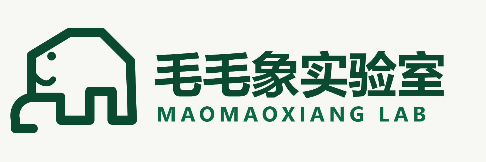

# Maomaoxiang Lab · 毛毛象实验室

**Open hardware for edge-AI vision — SoC boards, camera modules, and reproducible engineering notes.**

## What we build

Open, documented vision hardware for engineers. Pick a SoC, pair a camera module, and ship.

| Series | Tier | Status |
|---|---|---|
| **MERCURY-1106** (RV1106) | Entry — low power, 1 TOPS NPU | Sampling |
| **VENUS-1126** (RV1126) | Mid-range | Planned |
| **MARS-3576** (RK3576) | High-end, multi-camera | Planned |
| **JUPITER-3588** (RK3588) | Flagship, 8K | Planned |

Camera modules: **LUNA-SC233HGS** (global shutter, current pairing) · IO-IMX586 · SIRIUS-IMX678 · GANYMEDE-IMX989 (planned).

Every board ships with open schematics, a full SDK and honest documentation — no black boxes.

## Sites

| Site | What's there |
|---|---|
| [www.maomaoxiang.com](https://www.maomaoxiang.com) | Product homepage — photos, highlights, roadmap |
| [docs.maomaoxiang.com](https://docs.maomaoxiang.com) | Specifications, dimensions, SDK downloads, FAQ |
| [blog.maomaoxiang.com](https://blog.maomaoxiang.com) | Hands-on notes: motor control, PCB design, ISP, FPV links |

## Topics we work on

Embedded Linux · Rockchip RV1106 / RV1126 / RK3576 / RK3588 · camera sensors & ISP · FOC motor control · STM32 · compact PCB design · edge AI inference

## Contact

Open an issue on any repo, or reach us through the sites above. Hardware collaboration and reproducible teardowns welcome.
